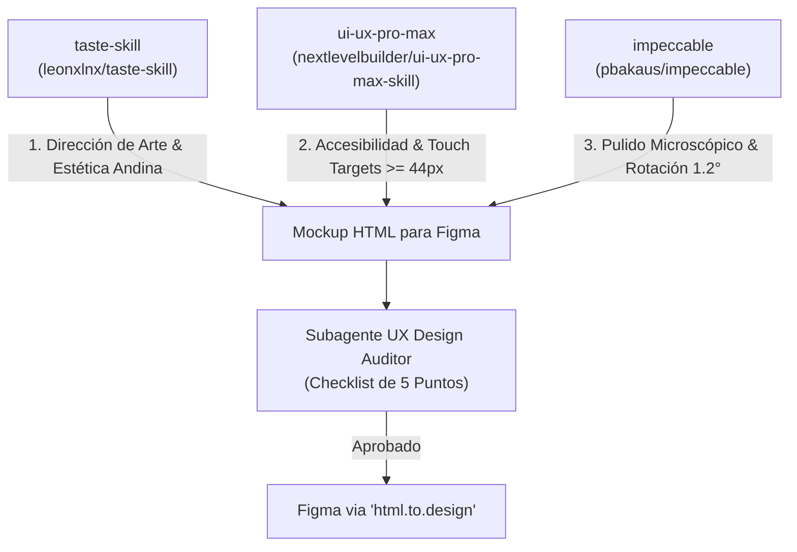

# Manual Oficial de Estilo, Arquitectura de Componentes y Guía de Interfaz — PuraSed (Sereno Moreno)
**Equipo de Desarrollo:**
* **Angelo Conterón:** Frontend & UI/UX Lead
* **Ángel Chicaiza:** Backend & Data Architect
* **Jannys Garrido Pazmiño:** Scrum Master & Fullstack Developer

**Cátedra:** ITID 803 — Diseño de Aplicaciones y Servicios para Internet  
**Docente:** Ing. Jose Naranjo | Escuela Politécnica Nacional (EPN - FIEE)  
**Semestre / Sprint:** Sprint 2 — Sistema Central PuraSed (Fase de Diseño & Mockups en Figma)  

---

## 1. Filosofía Visual: ¿Cuál es la Identidad de PuraSed?

El diseño de **PuraSed** se fundamenta en la identidad de **Taller Indie Craft & Herencia Andina** propia del restaurante *Sereno Moreno* (Centro Histórico de Quito). No es una aplicación SaaS convencional ni un punto de venta genérico.

### 1.1 Lo que ESTRICTAMENTE NO se usa:
* **Prohibido:** Fondos café chocolate planos o apagados (`#4a1d0d`).
* **Prohibido:** Bordes redondos hiper-redondeados tipo iOS/Bootstrap genérico (cero botones pastilla inflados con bordes circulares para textos).
* **Prohibido:** Emojis infantiles, iconos de fuentes genéricas desalineadas o degradados fluorescentes/neón.
* **Prohibido:** Texto blanco genérico sobre fondos de colores cálidos o terrosos cuando deba usarse tinta tipográfica serigráfica.

### 1.2 Lo que SÍ caracteriza a PuraSed:
1. **Pizarra y Carbón Basalto (`#121614` / `#1F2421`):** Estructura base moderna, sobria y de alto contraste.
2. **Colores Andinos Saturados Mate por Capítulo:** Cada sección posee su propio clima cromático basado en ingredientes ancestrales:
   - **Mucha Chicha:** Ámbar maíz fermentado (`#E8923E` a `#BA6920`).
   - **Pida No Más:** Terracota de paila de bronce (`#B85335` a `#853720`).
   - **Lleve Lleve:** Verde salvia y romero (`#637761` a `#425240`).
   - **Si Hay Si Hay:** Añil denim / pizarra oscura (`#405A6E` a `#273A48`).
   - **Oro Ancestral:** Basalto noche con oro Inti (`#2A312D` a `#141715`).
3. **Tintas Serigráficas Artesanales:** Los títulos sobre fondos de color se estampan en **tinta oscura profunda** (café espresso o negro carbón), emulando tipos móviles de madera y serigrafía sobre cartón.
4. **El Ticket de Papel Artesanal:** Las comandas, listas de pedidos y recibos se materializan en tarjetas de papel blanco tiza (`#FFFDF9`) con ligera rotación física (1° a 2°), sombra proyectada profunda y línea de corte troquelada.
5. **Grabados Ancestrales de Fondo:** Siluetas de linograbados andinos (Diablo Huma, campesinos, bebedor de chicha) tratados en tinta negra multiplicada (`multiply` al 22-25%) o tiza blanca luminosa (`screen` al 35% en fondos oscuros).

---

## 2. Paleta Cromática y Tokens CSS Oficiales

Cada componente y pantalla en Figma debe diseñarse exclusivamente con estos tokens:

```css
:root {
  /* =========================================================
     FONDOS ESTRUCTURALES Y BASES
     ========================================================= */
  --bg-dark-base: #121614;       /* Carbón basalto profundo (Dock, Navbar, Barra) */
  --bg-slate-charcoal: #1F2421;  /* Pizarra andina (Tarjetas oscuras, Módulo Identidad) */
  --bg-ticket-paper: #FFFDF9;    /* Papel artesanal blanco tiza para tickets */

  /* =========================================================
     TEXTOS Y ACENTOS
     ========================================================= */
  --text-chalk: #F5EADB;         /* Blanco tiza andina (Texto principal sobre fondos oscuros) */
  --text-dark-ink: #1A201C;      /* Tinta negra (Texto sobre tickets de papel) */
  --gold-inti: #E59F38;          /* Oro Inti / Maíz ancestral (Botones principales, acentos) */
  --gold-highlight: #F8AD00;     /* Oro radiante (Puntos activos, badges y focos) */

  /* =========================================================
     CAPÍTULOS TEMÁTICOS (GRADIENTES, TÍTULOS Y TAGS)
     ========================================================= */
  /* Capítulo 0: Mucha Chicha */
  --chicha-gradient: radial-gradient(circle at 65% 50%, #E8923E 0%, #D47E2F 55%, #BA6920 100%);
  --chicha-title-ink: #241002;
  --chicha-tag-color: #3D1C06;

  /* Capítulo 1: Pida No Más (Cocina de Paila) */
  --pida-gradient: radial-gradient(circle at 65% 50%, #B85335 0%, #9E4429 55%, #853720 100%);
  --pida-title-ink: #1F0802;
  --pida-tag-color: #381206;

  /* Capítulo 2: Lleve Lleve (Mercado al Vacío) */
  --lleve-gradient: radial-gradient(circle at 65% 50%, #637761 0%, #546652 55%, #425240 100%);
  --lleve-title-ink: #0E170C;
  --lleve-tag-color: #1B291A;

  /* Capítulo 3: Si Hay Si Hay (Arte & Merch) */
  --merch-gradient: radial-gradient(circle at 65% 50%, #405A6E 0%, #344B5C 55%, #273A48 100%);
  --merch-title-ink: #070E14;
  --merch-tag-color: #13222D;

  /* Capítulo 4: Oro Ancestral (Cultura & Identidad) */
  --identidad-gradient: radial-gradient(circle at 65% 50%, #2A312D 0%, #1F2421 55%, #141715 100%);
  --identidad-title-ink: #F8AD00;
  --identidad-tag-color: #F8AD00;
  --identidad-shadow: 0 4px 20px rgba(0, 0, 0, 0.85);
}
```

---

## 3. Tipografía Oficial y Jerarquía de Texto

En todo el sistema se emplean **únicamente 2 familias tipográficas**:

### 3.1 `Bebas Neue` (Display / Mayúsculas / Cartelería / Precios)
* **Regla estricta:** Se usa **SIEMPRE EN MAYÚSCULAS**.
* **Espaciado:** `letter-spacing: 2px a 3.5px`.
* **Interlineado:** `line-height: 0.92` a `0.96` (condensado y compacto, sin separación exagerada).
* **Uso:** Títulos principales de sección, números de mesa (`MESA 04`), montos de dinero (`$12.00`), cabeceras de tickets y botones principales de acción.

```css
font-family: 'Bebas Neue', 'Oswald', sans-serif;
letter-spacing: 2.5px;
text-transform: uppercase;
line-height: 0.92;
```

### 3.2 `Space Grotesk` (UI / Datos / Formularios / Descripciones)
* **Regla estricta:** Para contenido de lectura continua, descripciones de platos, etiquetas técnicas, notas de cocina, tablas de base de datos y detalles de comanda.
* **Pesos:** `400` (Regular) para notas, `600` / `700` (Bold) para nombres y subtítulos.

```css
font-family: 'Space Grotesk', -apple-system, BlinkMacSystemFont, sans-serif;
```

---

## 4. Estándar de Cabecera y Formato de Sección

Tanto en la vista de **Columnas** como en la vista **Expandida**, el encabezado de sección debe seguir obligatoriamente este formato jerárquico en Figma:

```html
<!-- Cabecera Oficial de Sección -->
<header class="section-header">
  <span class="category-tag" style="color: var(--seccion-tag-color);">NOMBRE DE CATEGORÍA</span>
  <h1 class="section-title" style="color: var(--seccion-title-ink);">
    PRIMERA PALABRA<br>SEGUNDA PALABRA
  </h1>
</header>
```

```css
.category-tag {
  font-family: 'Space Grotesk', sans-serif;
  font-size: 0.88rem;
  font-weight: 800;
  letter-spacing: 2.5px;
  text-transform: uppercase;
  margin-bottom: 5px;
  display: inline-block;
  line-height: 1;
  /* PROHIBIDO añadir fondos redondeados, pill-boxes oscuras o bordes */
  background: none !important;
  border: none !important;
  padding: 0 !important;
}

.section-title {
  font-family: 'Bebas Neue', sans-serif;
  font-size: clamp(2.8rem, 4.4vw, 4.8rem);
  font-weight: 700;
  letter-spacing: 2px;
  text-transform: uppercase;
  margin: 0;
  line-height: 0.92;
  text-align: center;
}
```

---

## 5. Metodología de Trabajo: Prototipado Rápido con Código HTML para Figma ("HTML to Figma")

> [!IMPORTANT]
> **Aclaración Arquitectónica Fundamental:**  
> En esta fase de la materia **NO estamos desarrollando la aplicación Blazor definitiva**. El código HTML/CSS desarrollado (como `test-orbital.html`) es un **vehículo de prototipado rápido y generación de mockups** para alimentar plugins como *html.to.design* en Figma.  
> Esto permite generar capas, vectores y textos 100% editables en Figma sin dibujar cada píxel a mano, manteniendo el código de producción en `PuraSed.Client/` completamente limpio de experimentos.

### 5.1 Flujo Operativo del Equipo
1. **Maquetar el mockup en HTML/CSS:** Construir o ajustar la pantalla en el archivo de referencia de mockups.
2. **Ejecutar o visualizar localmente:** Abrir el archivo en el navegador para verificar proporciones, colores y alineación.
3. **Importar a Figma ("HTML to Figma"):**
   - Abrir Figma y activar el plugin **html.to.design** (o extensión de navegador).
   - Ingresar la URL local (vía Live Server) o cargar el archivo HTML.
   - El plugin convertirá automáticamente el DOM, tipografías, sombras y vectores en componentes nativos de Figma con Auto Layout.
4. **Exportar PNG oficial a Git:** Exportar el marco resultante a `Entregables/Mockups_Figma/` a resolución `@2x`.

---

## 6. Uso Controlado de Tecnologías Avanzadas: Three.js = Premium 3D Motion Graphics

Para lograr una presentación visual de impacto en los mockups (rotaciones milimétricas de botellas, sombras en perspectiva y movimiento fluido de objetos héroe), el equipo tiene autorización para integrar librerías como **Three.js** bajo normas estrictas de contención:

### 6.1 ¿Para qué se utiliza Three.js en los Mockups?
* **Orientación exacta del producto:** Permite rotar la botella de Mucha Chicha a **-45° antihorario** o inclinar la cazuela de locro para revelar el linograbado del Diablo Huma detrás.
* **Iluminación y sombras físicas:** Genera reflejos de vidrio y sombras de oclusión ambiental (`drop-shadow` suave multicapa) que lucen hiperrealistas al importarse a Figma.
* **Profundidad de capas (Parallax):** Simula el movimiento tridimensional de la tríada de columnas antes de congelar el estado visual en Figma.

### 6.2 Reglas de Oro para NO desorganizar el proyecto con Three.js:
1. **Carga Exclusiva por CDN en el Mockup:**  
   Importar Three.js únicamente dentro del `<head>` del archivo HTML de mockup mediante CDN:
   ```html
   <script src="https://cdnjs.cloudflare.com/ajax/libs/three.js/r128/three.min.js"></script>
   ```
   **PROHIBIDO** descargar librerías pesadas en `PuraSed.Client/wwwroot/lib/three/` durante esta fase de diseño.
2. **Código Autocontenido:** El script de renderizado 3D debe permanecer encapsulado dentro del propio archivo de mockup o en un script específico de apoyo.
3. **Cámara Ortográfica o Perspectiva Controlada:** Configurar la cámara de Three.js con un campo de visión cerrado (`fov: 35` a `45`) para evitar distorsiones angulares al capturar la interfaz para Figma.

---

## 7. Catálogo Oficial de Insumos Gráficos (25 Imágenes Depuradas)

Tras la limpieza de archivos redundantes y fotos crudas de cámara (reduciendo el tamaño de 162 MB a **40 MB**), el repositorio contiene **únicamente las 25 imágenes activas** que componen el diseño de referencia:

### 7.1 Grabados Andinos y Emblemas (`catalogo_imagenes/drawings/`)
1. `logosm.svg`: Logo oficial del Bar & Mercado Sereno Moreno.
2. `diablo-huma-emblem.png`: Emblema sagrado del Diablo Huma.
3. `recurso-16.png`: Linograbado ancestral del Diablo Huma (Fondo Mucha Chicha).
4. `recurso-17.png`: Linograbado ancestral del Danzante tradicional (Fondo Lleve Lleve).
5. `recurso-18.png`: Linograbado botánico de hojas y maíz (Fondo Si Hay Si Hay).
6. `recurso-20.png`: Linograbado del Catador de Chicha tradicional (Fondo Pida No Más).
7. `mascara_diablo_huma_float.png`: Máscara artesanal sagrada (Héroe Capítulo 4: Oro Ancestral).

### 7.2 Fermentos Vivos (`catalogo_imagenes/fermentos/`)
8. `botella_roja_float.png`: Botella esmerilada de Mucha Chicha Maíz Rojo (Héroe Sección 0).
9. `botella_amarilla_float.png`: Botella Mucha Chicha Maíz Clásico Amarillo.
10. `lata_morado_float.png`: Lata artesanal de maíz morado (500 ml).
11. `lata_morocho_float.png`: Lata artesanal de maíz morocho (500 ml).
12. `lata_yuca_float.png`: Lata artesanal de fermento amazónico de yuca viva (500 ml).

### 7.3 Cocina de Paila (`catalogo_imagenes/pida_no_mas/`)
13. `locrito_de_papa_5.50_float.png`: Cazuela de locrito de papa con aguacate y tostado (Héroe Sección 1).
14. `hongos_portobello_float.png`: Portobellos andinos al ajillo con chicha.
15. `ceviche_de_coco_float.png`: Ceviche fresco de coco biche con palmito y chifles.
16. `choclopapaconqueso_float.png`: Choclo tierno desgranado con papas chauchas.
17. `maduroconqueso_float.png`: Maduro asado en fogón con queso tierno.

### 7.4 Mercado al Vacío (`catalogo_imagenes/lleve_lleve/`)
18. `costilla_precocida_float.png`: Costilla de cerdo sellada al vacío (Héroe Sección 2).
19. `codillo_precocido_float.png`: Codillo glaseado empacado al vacío.
20. `muchines_yuca_float.png`: Empaque congelado de muchines de yuca.
21. `queso_hoja_float.png`: Queso de pasta hilada en hoja de achira.

### 7.5 Arte & Merch (`catalogo_imagenes/si_hay_si_hay/`)
22. `camiseta_verde_float.png`: Camiseta verde Sereno Moreno (Héroe Sección 3).
23. `gorra_sereno_float.png`: Gorra trucker con parche bordado de luna.
24. `totebag_linografia_float.png`: Bolso tote bag de lona con grabado botánico.
25. `vaso_artesanal_float.png`: Vaso cervecero artesanal serigrafiado.

---

## 8. Guía de Uso de las 3 Skills de Diseño e IA y Subagente de Auditoría

Para asegurar que todo el equipo (Angelo, Ángel Chicaiza y Jannys Garrido) utilice la inteligencia artificial con rigor profesional y coherencia estética, se define el rol y método de uso de cada herramienta:

### 8.1 Las 3 Skills Especializadas de Diseño



#### 1. `leonxlnx / taste-skill` (`design-taste-frontend`)
* **Propósito:** Actúa como Director de Arte *anti-slop*. Evita que las interfaces parezcan plantillas corporativas SaaS genéricas (estilo Stripe o Tailwind genérico) y asegura la identidad de cantina craft andina.
* **Instrucción de uso para el equipo:**  
  *Al maquetar una nueva pantalla, pídele al agente:*
  > "Aplica taste-skill: genera el layout para la sección 'Cocina de Paila' usando los tokens de PuraSed, evitando degradados artificiales o bordes pastilla modernos. Debe respirar serigrafía artesanal y contraste sobre carbón basalto."

#### 2. `nextlevelbuilder / ui-ux-pro-max-skill` (`ui-ux-pro-max`)
* **Propósito:** Ingeniero de Usabilidad, Layout y Accesibilidad. Asegura que la interfaz sea plenamente operativa para el personal del restaurante.
* **Instrucción de uso para el equipo:**  
  *Al diseñar formularios, botones de comanda o grillas de productos:*
  > "Aplica ui-ux-pro-max: valida que todos los botones de acción (+ COMANDA, MANDAR A COCINA) tengan un área de toque mínima de 44x44px para dedos en pantalla táctil, relación de contraste de texto &ge; 4.5:1 (WCAG AA) y jerarquía visual clara."

#### 3. `pbakaus / impeccable` (`impeccable`)
* **Propósito:** Auditor y Refinador de Detalles Microscópicos de UI.
* **Instrucción de uso para el equipo:**  
  *Al ultimar detalles antes de exportar a Figma:*
  > "Aplica impeccable: inspecciona paddings, alineaciones del ticket de papel artesanal (inclinación de 1.2°), sombras drop-shadow suaves y verifica el estado vacío cuando no hay ítems en la comanda."

### 8.2 Subagente de Auditoría Heurística
Antes de convertir cualquier pantalla HTML a Figma, cualquier miembro del equipo debe correr el **Subagente Auditor** con el siguiente prompt formal:

```markdown
> Rol: UX Design Auditor — PuraSed (ITID 803)
> Tarea: Audita este código de mockup contra la Guía Oficial (Entregables/Guia_Diseno_UI_UX_PuraSed.md):
> 1. ¿Usa exclusivamente los tokens cromáticos oficiales (Basalto, Oro Inti, Gradientes Andinos)?
> 2. ¿Los títulos display están en Bebas Neue en mayúsculas y los datos en Space Grotesk?
> 3. ¿El ticket de comanda tiene apariencia de papel artesanal con rotación de 1.2° y sombra física?
> 4. ¿Los objetos héroe están desplazados 3 a 4 cm hacia abajo y la botella de chicha rotada a -45° para despejar el grabado andino?
> 5. ¿El paginador inferior es único y está centrado en la base de la pantalla (pastilla de 18x6px)?
```

---

## 9. Políticas de Git: ¿Qué se sube al Repositorio para la Entrega?

Para evitar confusiones, desorden y riesgos de penalización (**Nota de 0.1** según `GEMINI.md`):

### 9.1 Archivos que SÍ se incluyen en el Commit de Git:
1. **`Entregables/Guia_Diseno_UI_UX_PuraSed.md`**: Este documento formal que sirve de guía técnica para el equipo y evaluación docente.
2. **`Entregables/Mockups_Figma/`**: Directorio oficial donde se almacenan el enlace al proyecto de Figma (`README.md`) y las exportaciones PNG en alta resolución de las pantallas terminadas para entrega y calificación.
3. **`PuraSed.Client/wwwroot/catalogo_imagenes/`**: Catálogo limpio de 25 imágenes oficiales recortadas y transparentes (40 MB).
4. **`PuraSed.Client/wwwroot/index.html`**: Enlace limpio a las fuentes Google Fonts (*Bebas Neue* y *Space Grotesk*).

### 9.2 Archivos que NO se suben a Git (Quedan Locales y Protegidos):
1. **`prototipos_referencia/`**: Carpeta local donde guardamos `test-orbital.html` y `Menu.razor` como referencia visual interactiva para cuando pasemos de Figma a código.
2. **`backups/`**: Copias de seguridad locales del desarrollador (incluyendo `backup_all_images_original` con las 97 fotos originales).
3. **`scripts_archive/`**: Archivo histórico local de scripts de procesamiento gráfico.
4. **`bin/`, `obj/`, `.vs/`**: Bloqueados en `.gitignore` por reglamento institucional.
